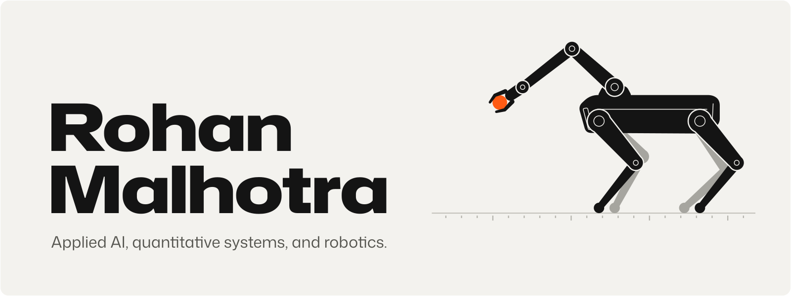

  <a href="https://rohanm.org">
    <picture>
      <source media="(prefers-color-scheme: dark)" srcset="assets/hero-dark.svg">
      
    </picture>
  </a>

Hi, I am Rohan. I study Math & CS at NYU Courant and am on track to graduate in 3 years, in May 2027. My last internship was at IBM, where I [trained a Boston Dynamics Spot to find a dog toy](https://www.youtube.com/watch?v=ba-QHNwbSI4). At Kalshi, I built tools to hedge job-loss risk with prediction markets.

[rohanm.org](https://rohanm.org) · [LinkedIn](https://www.linkedin.com/in/rohanamal) · [Email](mailto:rohanmalhotra8974@gmail.com)
